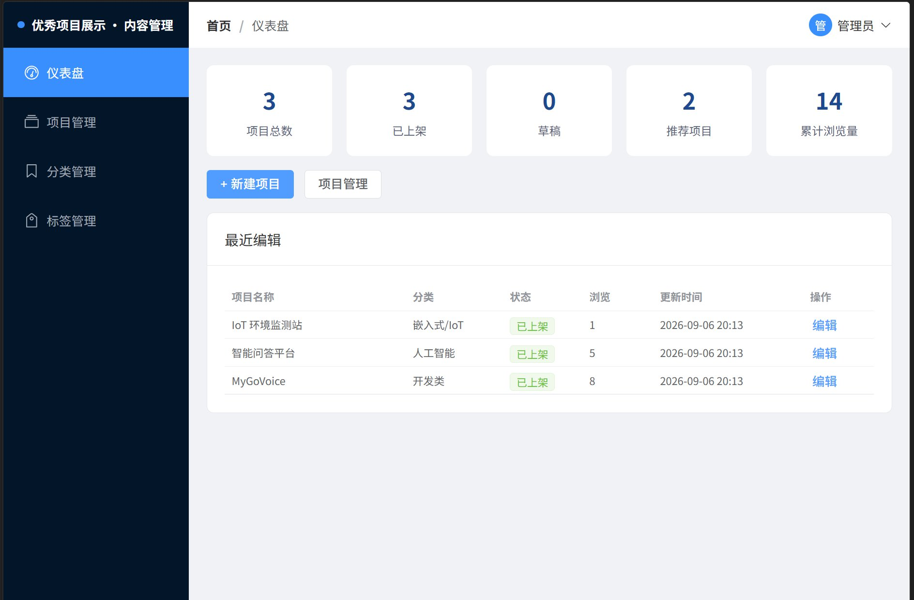

# 大连理工大学实训基地优秀项目展示系统

> 一个可以浏览、发现、阅读「实训优秀项目作品」的内容网站。

把优秀实训项目当作**可阅读的作品**来展示，而不是数据库里的一条记录。参考 Reddit 的内容发现、Pixiv 的作品展示与小红书的卡片浏览，但不引入点赞、评论、收藏、关注等社交机制。


---

## 功能特性

**前台展示站**

- 首页聚合：推荐位、分类合集、热力榜
- 全部项目：按分类 / 标签筛选，按推荐 / 最新 / 浏览量排序
- 搜索：首页搜索框输入即联想，点击直达详情，回车进入搜索结果页
- 作品详情：正文按内容块渲染成文章，附成员与标签

**管理后台**

- 管理员登录（JWT 鉴权）
- 仪表盘统计
- 项目管理：新建、编辑、上下架、推荐位、删除
- 内容块编排：小节标题 / 段落 / 图片，可拖拽排序，整单保存
- 分类与标签管理
- 图片上传

**后端服务**

- REST 接口，统一响应体
- 内容块单事务全量替换
- JWT 鉴权与路由保护
- 本地图片存储，可切换对象存储



---

## 技术栈

| 层 | 选型 |
| --- | --- |
| 前台展示 | Vue 3 + Vite + Pinia + Vue Router + Axios |
| 管理后台 | Vue 3 + Vite + Element Plus + Pinia |
| 后端 | Go 1.26 + Gin + GORM |
| 数据库 | MySQL 8.0（utf8mb4，9 张表 AutoMigrate） |
| 部署 | Docker Compose（mysql + backend + nginx） |

---

## 快速开始

### 方式一：Docker 一键部署（推荐）

前置条件：安装并启动 Docker Desktop。

```bash
docker compose up -d --build
```

| 入口 | 地址 |
| --- | --- |
| 前台展示站 | http://localhost |
| 管理后台 | http://localhost:8081 |

默认管理员账号 `admin`，初始密码 `admin123456`（首次登录后请修改）。

常用命令：

```bash
docker compose ps            # 查看服务状态
docker compose logs -f backend
docker compose down          # 停止（保留数据卷）
docker compose down -v       # 停止并清空数据
```

前端在镜像构建阶段编译，后端为多阶段静态构建，无需在宿主机安装 Go 或 Node。

### 方式二：本地开发

前端两个项目分别启动：

```bash
cd frontend-showcase && npm install && npm run dev   # 前台 :5173
cd frontend-admin    && npm install && npm run dev   # 后台 :5174
```

后端：

```bash
cd backend
cp .env.example .env    # 按需修改数据库密码等配置
go run .                # 监听 :8080
```

后端启动时会自动建表；空库时额外写入管理员账号与演示数据。开发期由 Vite 把 `/api` 与 `/uploads` 代理到 `:8080`，前端代码始终使用相对路径。

---

## 目录结构

```
.
├── backend/               Go 后端
│   ├── config/            配置加载（环境变量）
│   ├── model/             数据模型
│   ├── dto/               请求与响应结构
│   ├── repository/        数据访问（GORM）
│   ├── service/           业务逻辑与事务
│   ├── handler/           HTTP 处理与参数校验
│   ├── router/            路由与中间件
│   ├── scripts/           建库与清库脚本
│   └── uploads/           上传图片
├── frontend-showcase/     Vue 3 前台展示站
├── frontend-admin/        Vue 3 管理后台
├── deploy/                nginx 镜像与网关配置
├── scripts/               项目数据导入与同步脚本
├── tests/                 黑盒测试（功能 + 性能）
├── docs/                  设计文档与交付文档
└── docker-compose.yml
```

---

## 核心设计

### 1. 以「有序内容块」承载正文

项目详情不是几十个零散字段，而是由有序内容块组成：

| 类型 | 说明 |
| --- | --- |
| heading | 小节标题 |
| paragraph | 段落 |
| image | 图片（含说明文字） |

内容块按 `sort_order` 排列，整体构成一篇作品文章。管理员在后台编辑的是一篇文章，而不是填写一张表单，这是本项目与其他项目管理系统的根本区别。

### 2. 整单保存：单事务全量替换

后台一次提交基础信息、标签、成员与内容块，后端在单个事务内先删除后批量插入，保证顺序一致与原子性，避免块级 diff 带来的复杂度，也不会出现半成品数据。

### 3. 搜索是一级交互

首页中央搜索框，输入即联想（前端 200ms 防抖 + AbortController 取消过期请求），点击结果直达详情，回车进入搜索结果页。30 个项目规模下使用 SQL 模糊匹配即可满足。

### 4. 数据库主从划分

| 类型 | 表 |
| --- | --- |
| 基础表 | users、categories、tags |
| 主表 | projects |
| 从表 | project_content_blocks、project_members、project_images、project_tags、visit_logs |

---

## 接口概览

**前台接口（公开）**

| 方法 | 路径 | 说明 |
| --- | --- | --- |
| GET | `/api/home` | 首页聚合：推荐 + 分类 + 最新 |
| GET | `/api/projects` | 项目列表，支持 keyword / category_id / tag_id / sort / page |
| GET | `/api/projects/:id` | 项目详情，浏览量加一 |
| GET | `/api/search/suggest` | 搜索联想 |
| GET | `/api/categories` | 分类列表 |
| GET | `/api/tags` | 标签列表 |

**后台接口（需 JWT）**

| 方法 | 路径 | 说明 |
| --- | --- | --- |
| POST | `/api/auth/login` | 登录获取 token |
| GET | `/api/auth/me` | 当前登录用户 |
| GET | `/api/admin/overview` | 仪表盘统计 |
| GET / POST | `/api/admin/projects` | 项目列表 / 新建 |
| GET / PUT / DELETE | `/api/admin/projects/:id` | 详情回显 / 整单保存 / 删除 |
| PUT | `/api/admin/projects/:id/status` | 上下架 |
| PUT | `/api/admin/projects/:id/recommend` | 推荐位与排序 |
| GET / POST / PUT / DELETE | `/api/admin/categories` | 分类管理 |
| GET / POST / PUT / DELETE | `/api/admin/tags` | 标签管理 |
| POST | `/api/admin/upload` | 图片上传 |

统一响应格式：

```json
{ "code": 0, "message": "ok", "data": {} }
```

`code` 为 0 表示成功，非 0 为错误码；4xxxx 为客户端错误，5xxxx 为服务端错误。

---

## 测试

采用脚本化黑盒测试，直接调用接口并逐条断言，不依赖人工点击。

```bash
uv run --with requests python tests/functional_test.py   # 功能测试，51 条用例
uv run --with requests python tests/perf_test.py         # 性能测试，7 个场景
```

当前基线：功能用例 51 条，通过 47 条。未通过的 4 条为已知缺陷，集中在内容块字段校验、错误码映射与软删除唯一索引冲突，详见 `docs/黑盒测试报告.docx`（线下提交）。

测试数据统一使用「【测试】」前缀加随机后缀命名，用例结束后自动清理，不会污染演示数据。

---

## 文档

| 文档 | 内容 |
| --- | --- |
| [docs/00-README.md](docs/00-README.md) | 文档索引 |
| [docs/01-需求分析.md](docs/01-需求分析.md) | 需求分析 |
| [docs/02-后台UI设计.md](docs/02-后台UI设计.md) | 后台信息架构与交互 |
| [docs/03-数据库设计.md](docs/03-数据库设计.md) | 数据库设计（E-R、9 张表、索引） |
| [docs/04-UML设计.md](docs/04-UML设计.md) | 用例、类、时序、活动、组件、部署 |
| [docs/06-环境配置.md](docs/06-环境配置.md) | 环境配置与 Docker 一键部署 |
| [docs/09-前台设计方案.md](docs/09-前台设计方案.md) | 前台设计方案 |
| [docs/10-调用链设计.md](docs/10-调用链设计.md) | 前后端与数据库调用链 |
| [docs/11-UI设计和性能优化.md](docs/11-UI设计和性能优化.md) | UI 与性能优化清单 |
| [docs/12-前台影院化改造方案.md](docs/12-前台影院化改造方案.md) | 前台影院化改造 |

概要设计说明书、数据库设计表、黑盒测试报告、单体测试成绩书等正式交付文档按课程要求线下提交，未纳入本仓库。

---

## 团队分工

| 角色 | 成员 | 范围 |
| --- | --- | --- |
| 组长 / 后端 | 肖文浩 | 终审与提交、后端接口、部署运维 |
| 后端 | 王泽远、郭晨浩 | 接口、数据库、内容块事务 |
| 前端 | 马龙、郑亚林 | 前台展示站、管理后台 |

---

## 说明

本项目为大连理工大学实训课程设计作品，仅用于教学与展示。
